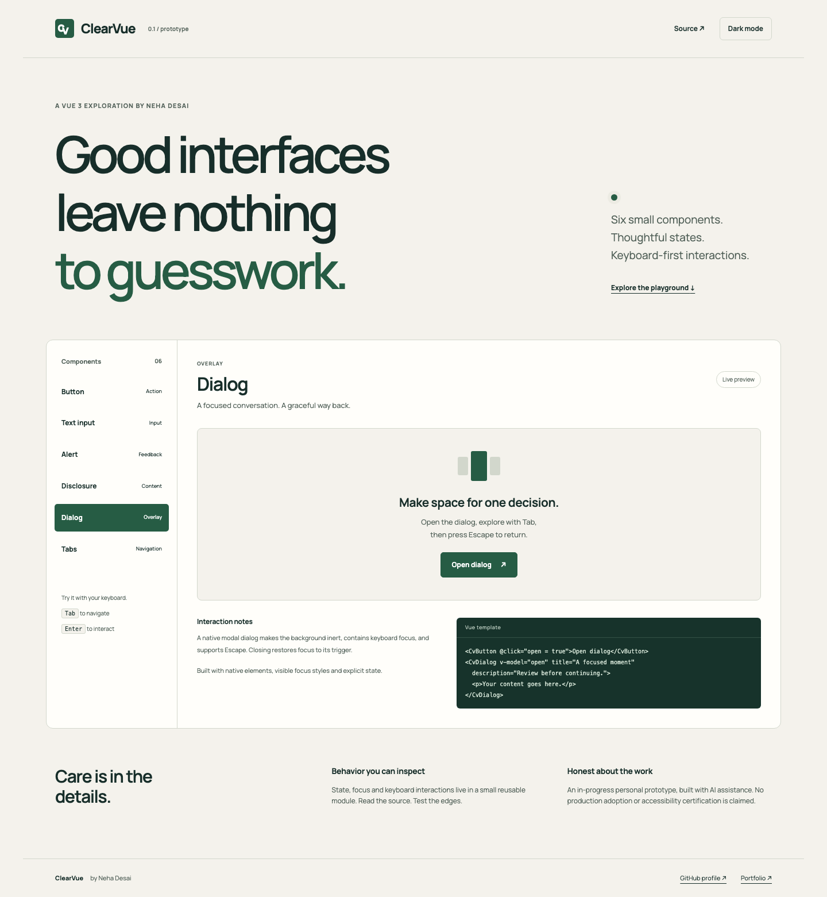

# ClearVue

A small, working Vue 3 component playground exploring explicit states and keyboard interaction. **Personal project, in progress. Not production-ready or WCAG certified.** Built for Neha Desai's portfolio with AI assistance; no client code or confidential screenshots.

[Open the playground](https://neha-pd.github.io/clearvue/) · [Neha's GitHub](https://github.com/neha-pd)



## What works

Six reusable Vue components in [`src/components.js`](src/components.js), used by the live playground:

| Component | Public interface | Behavior |
| --- | --- | --- |
| `CvButton` | `variant` (`primary`/`secondary`), `disabled`, `type`; default slot; native click | Native keyboard activation and disabled state |
| `CvTextInput` | `v-model`, `label`, `hint`, `error`, `id`, `required`, `type`; forwarded input attributes | Unique label/hint/error associations and `aria-invalid` |
| `CvAlert` | `title`, `tone`, `urgent`; default slot | Polite `status` by default, urgent `alert` opt-in |
| `CvDisclosure` | `label`, `initiallyOpen`; default slot | Native button, `aria-expanded` and controlled content |
| `CvDialog` | `v-model`, `title`, `description`; default scoped slot `{ close }` | Native `showModal()`, inert background, Escape and focus restoration |
| `CvTabs` | `label`, `tabs: [{ id, label, content }]`; optional named slot matching each tab id | Automatic activation, roving tabindex, arrows and Home/End |

Each instance uses Vue `useId()` for identifiers. Tabs are horizontal; provide unique, stable tab IDs. Keep the tabs array stable while mounted in this prototype.

## Run locally

No build step or package-manager installation required. Vue's official full browser ESM distribution is pinned and vendored, along with its MIT license. Fonts are self-hosted with their OFL license.

```sh
python3 -m http.server 8837
# Open http://localhost:8837
```

Browser modules need HTTP, not `file://`. GitHub Pages publishes `main` at the repository root. No analytics, API keys, forms sent to servers or backend storage. The demo email field validates locally; the theme preference uses localStorage.

## Reuse a component

```js
import { createApp, ref } from './vendor/vue.esm-browser.prod.js';
import { CvButton, CvDialog } from './src/components.js';

createApp({
  components: { CvButton, CvDialog },
  setup() { return { open: ref(false) }; },
  template: `
    <CvButton @click="open = true">Open dialog</CvButton>
    <CvDialog v-model="open" title="Review changes">
      <p>Use Escape to close.</p>
    </CvDialog>`
}).mount('#app');
```

Include `styles.css` for the prototype styles. The file currently contains both component styles and demo layout; separating the package CSS is a next step. Component modules import the same vendored Vue instance as the application. This is a browser module project, not an npm package.

## Validation and limits

`tests/browser.py` runs real Chromium interactions with Playwright:

```sh
python3 -m pip install playwright
python3 -m playwright install chromium
python3 tests/browser.py http://localhost:8837
```

Checks cover dialog initial focus, focus containment, Escape/return focus; tab arrow/Home/End behavior; input label/error associations and validation recovery; button/disclosure keyboard behavior; alert updates; theme persistence; and mobile overflow. Results and actual screenshots are in `artifacts/`.

Still needed before production use: manual VoiceOver/NVDA testing, Firefox/Safari coverage, systematic contrast audit, nested overlay handling, dynamically changing tabs, server-rendering validation, and application-specific validation. A passing browser interaction suite is not accessibility certification. Dialog depends on native `HTMLDialogElement.showModal()` support. The full browser Vue build uses runtime template compilation; a strict CSP application should precompile components with a build tool.

## Design decisions

- Native semantic elements first; ARIA adds relationships and state.
- A restrained green/neutral palette with visible focus styles and light/dark themes.
- No required animation; reduced-motion and reduced-transparency preferences are respected.
- Interaction notes sit next to a real preview and copyable template examples.
- Client work, adoption metrics and certifications are not implied by this demo.

Reference patterns: [Vue browser ESM](https://vuejs.org/guide/quick-start.html#using-the-es-module-build), [WAI tabs pattern](https://www.w3.org/WAI/ARIA/apg/patterns/tabs/), [native dialog](https://developer.mozilla.org/en-US/docs/Web/HTML/Reference/Elements/dialog). Visual direction informed by [taste-skill](https://github.com/leonxlnx/taste-skill).

## Roadmap

- Separate component/theme CSS from the demo shell.
- Add screen-reader review notes and Firefox/WebKit tests.
- Expand disabled and asynchronous states and document edge cases.
- Package only after the API and accessibility review stabilize.

MIT licensed. Vue and Manrope retain their respective upstream licenses in `vendor/` and `assets/`.
