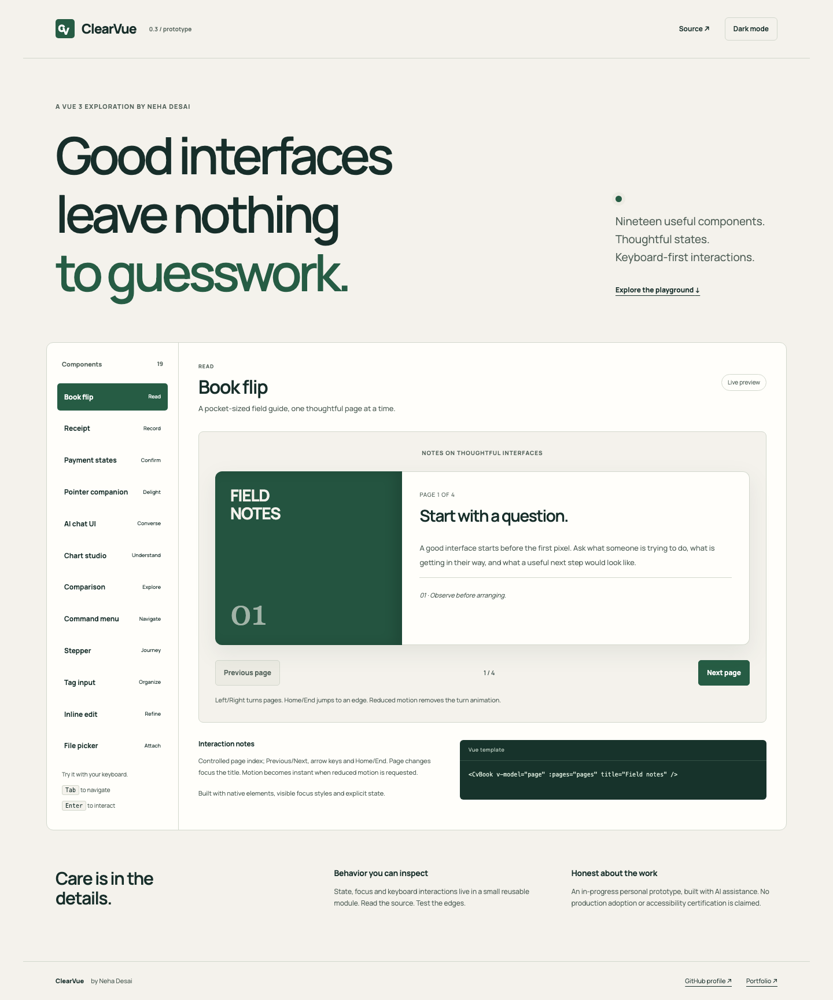

# ClearVue

A small, working Vue 3 component playground exploring explicit states and keyboard interaction. **Personal project, in progress. Not production-ready or WCAG certified.** Built for Neha Desai's portfolio with AI assistance; no client code or confidential screenshots.

[Open the playground](https://neha-pd.github.io/clearvue/) · [Neha's GitHub](https://github.com/neha-pd)



## What works

Nineteen reusable Vue components in [`src/components.js`](src/components.js) [`src/extended.js`](src/extended.js), and [`src/showcase.js`](src/showcase.js), used by the live playground:

| Component | Public interface | Behavior |
| --- | --- | --- |
| `CvButton` | `variant` (`primary`/`secondary`), `disabled`, `type`; default slot; native click | Native keyboard activation and disabled state |
| `CvTextInput` | `v-model`, `label`, `hint`, `error`, `id`, `required`, `type`; forwarded input attributes | Unique label/hint/error associations and `aria-invalid` |
| `CvAlert` | `title`, `tone`, `urgent`; default slot | Polite `status` by default, urgent `alert` opt-in |
| `CvDisclosure` | `label`, `initiallyOpen`; default slot | Native button, `aria-expanded` and controlled content |
| `CvDialog` | `v-model`, `title`, `description`; default scoped slot `{ close }` | Native `showModal()`, inert background, Escape and focus restoration |
| `CvTabs` | `label`, `tabs: [{ id, label, content }]`; optional named slot matching each tab id | Automatic activation, roving tabindex, arrows and Home/End |

Each instance uses Vue `useId()` for identifiers. Tabs are horizontal; provide unique, stable tab IDs. Keep the tabs array stable while mounted in this prototype.

## Seven additions in 0.2

| Component | Public interface | Behavior |
| --- | --- | --- |
| `CvComparison` | numeric `v-model` (0–100), `beforeSrc`, `afterSrc`, `beforeLabel`, `afterLabel`, required `description` | Native range reveal with arrow/Home/End support; direct links to each source image. No pointer-only gesture required. |
| `CvCommandMenu` | boolean `v-model`, `title`, `commands: [{id,label,description,disabled?}]`; `select(item)` | Local search, native result buttons, arrow/Home/End movement, empty state, native modal focus/Escape. No automatic global shortcuts. |
| `CvTagInput` | string-array `v-model`, `label`, `max` (5), `disabled` | Trimmed case-insensitive unique tags, Enter/add, max feedback, remove with focus return. 60 characters per new tag. |
| `CvInlineEdit` | string `v-model`, `label`, `disabled`, `maxLength` (80) | Isolated draft; Enter saves nonempty text, Escape cancels; focus returns to Edit. |
| `CvStepper` | zero-based numeric `v-model`, `steps: [{id,label}]`, `label`, `canContinue`, `blockedReason`; `complete` | Parent-owned validation, heading focus, Back/Continue/Finish. Named slots use each step id and receive `{index}`. |
| `CvFilePicker` | `label`, `accept` (.pdf,.txt), `maxBytes` (2,000,000), `disabled`; `select(File|null)`, `error(message)` | One native file at a time, local extension/MIME and size checks, remove. Does not read file contents, upload or persist files. |
| `CvCopyField` | required `value`, `label`, `disabled` | Clipboard API with progress/result feedback; denial selects text for manual copying. HTTPS/localhost needed for Clipboard API. |

Comparison sources accept HTTP(S) and relative paths; script/data URLs are not rendered or linked. The comparison uses actual captures of the original ClearVue demo (`artifacts/theme-light.png` and `theme-dark.png`), not rendered mockups. It is a visual comparison; supply a useful textual `description` for its content. The live command menu emits demo selections only; it neither navigates nor submits anything. The stepper's parent must save data and enforce business rules; a completion event is not a server submission.

### Compose a workflow

```js
import { CvTagInput, CvStepper } from './src/extended.js';
// Register these components in the same createApp instance as your own form.
```

```html
<CvTagInput v-model="focusAreas" label="Project focus" :max="5" />
<CvStepper v-model="step" :steps="[
  { id: 'brief', label: 'Brief' },
  { id: 'review', label: 'Review' }
]" :can-continue="step !== 0 || !!title.trim()"
  blocked-reason="Give the brief a title." @complete="prepareDraft">
  <template #brief><input v-model="title" aria-label="Brief title"></template>
  <template #review><p>{{ title }}</p></template>
</CvStepper>
```

Keep step IDs unique and the step array stable while mounted. Never place `CvInlineEdit` inside another form because it owns its own form. Incoming model changes during an inline edit do not overwrite the unsaved draft; the most recent save wins—resolve collaboration conflicts in your application. File type checks are a usability aid, **not a security boundary**: inspect and validate files again on a server before processing. Copy feedback requires actual clipboard success; permission denial does not claim a copy succeeded. Labels and descriptions are rendered as text, not HTML.

## Showcase additions in 0.3

| Component | Public interface | Responsibility |
| --- | --- | --- |
| `CvBook` | zero-based `v-model`, `title`, `pages: [{title,body,note?}]` | Native previous/next, Left/Right/Home/End while focused inside, title focus after navigation, page-turn animation with reduced-motion override. Empty pages show an explanation. Text only. |
| `CvReceipt` | `receipt: {merchant,id,date,currency,items:[{label,amountCents}],note?}`, `fictional` (true); events `copy`, `download`, `print`, `error` | Derives a total from integer cents; downloads a `.txt` receipt, copies actual text, invokes browser print. No payment confirmation is inferred. Supply validated finite integer amounts and a supported ISO currency. |
| `CvPaymentState` | `state` (`success`/`pending`/`failure`), display strings `amount`, `reference`, `message`, `fictional` (true); `retry`, `done` events | Presentation only. **Never** use this component's state or retry event as proof that a payment succeeded or that retrying is safe. A backend/provider must own reconciliation and idempotency. |
| `CvMascot` | `name` (Pip), `enabled` (true); `pause-change(boolean)` | Decorative, pointer-events disabled; follows a fine pointer with direct DOM transforms in a single animation loop. Pause/resume, reduced-motion and coarse-pointer stationary fallback. Cleans up its listeners/animation when unmounted. |
| `CvChat` | `messages`, `status` (`idle`/`loading`/`streaming`/`error`), `error`, `title`, `simulated` (true); `send(text)`, `retry`, `stop` | Controlled presentation. Enter sends, Shift+Enter adds a line, IME composition is respected. Plain text, HTTP(S) citations, embedded `CvChart`. Announcements describe state changes instead of every streaming token. No model, network, persistence or Markdown/HTML execution. |
| `CvChart` | `type` (`line`/`area`/`bar`/`donut`/`radar`/`heatmap`), `title`, `description`, `data:[{label,value,column?,row?}]`, `unit` | Apache ECharts SVG renderer, responsive ResizeObserver, theme updates, reduced-motion-aware animation, keyboard-readable values and full data table. Currently accepts finite non-negative numbers only. Heatmap uses optional row/column labels. |

`CvChat` messages have `{id,role:'user'|'assistant',text,citations?:[{title,url}],chart?:{type,title,description,data,unit}}`. Keep message IDs unique. Parent code owns asynchronous requests, cancellation, retry deduplication, authorization and any message retention. This demo's timer produces a clearly fictional dataset; its links are framework references, not evidence for simulated business results. No user content is sent to an AI service. The message history is focusable and scrollable without forcing a reader to the bottom.

```html
<CvBook v-model="page" title="Field notes" :pages="[
  {title:'A useful first step',body:'Start with the task.'},
  {title:'A clear way back',body:'Preserve the draft.'}
]" />
<CvPaymentState :state="providerState" amount="$128.00"
  reference="SAMPLE-0128" :fictional="true" @retry="requestSafeRetry" />
<CvChat :messages="messages" :status="status" :error="error"
  @send="send" @retry="retry" @stop="stop" :simulated="true" />
<CvChart type="bar" title="Sample review activity" unit="reviews"
  :data="[{label:'Mon',value:8},{label:'Tue',value:14}]" />
```

The browser demo loads the official npm `echarts` **6.1.0** distribution from `vendor/echarts.min.js`; include that script before using `CvChart` or chart messages. No runtime CDN is required. Origin/version/integrity metadata is in `vendor/echarts-source.json`; Apache2 license and notice files are retained. ECharts adds approximately1.12MB of uncompressed JavaScript; a production bundle should import only its required chart modules. The existing six primitives and seven0.2 components do not depend on ECharts.

The mascot is deliberately decorative and CSS-drawn, not an image of a person or a fake product screenshot. Book copy is original sample prose. Receipt merchant, amounts and payment states are fictional. Print uses the browser's dialog (not silent printing); the included print stylesheet isolates a receipt on this demo page. Print rules may need scoping in a host application.

## Run locally

No build step or package-manager installation required. ECharts and Vue's official full browser ESM distribution is pinned and vendored, along with its MIT license. Fonts are self-hosted with their OFL license.

```sh
python3 -m http.server 8837
# Open http://localhost:8837
```

Browser modules need HTTP, not `file://`. GitHub Pages publishes `main` at the repository root. No analytics, API keys, forms sent to servers or backend storage. The demo email field validates locally; the theme preference uses localStorage.

## Reuse a component

```js
import { createApp, ref } from './vendor/vue.esm-browser.prod.js';
import { CvButton, CvDialog } from './src/components.js';

createApp({
  components: { CvButton, CvDialog },
  setup() { return { open: ref(false) }; },
  template: `
    <CvButton @click="open = true">Open dialog</CvButton>
    <CvDialog v-model="open" title="Review changes">
      <p>Use Escape to close.</p>
    </CvDialog>`
}).mount('#app');
```

Include `styles.css` for the prototype styles. The file currently contains both component styles and demo layout; separating the package CSS is a next step. Component modules import the same vendored Vue instance as the application. This is a browser module project, not an npm package.

## Validation and limits

`tests/browser.py` runs real Chromium interactions with Playwright:

```sh
python3 -m pip install playwright
python3 -m playwright install chromium
python3 tests/browser.py http://localhost:8837
python3 tests/extended.py http://localhost:8837
python3 tests/showcase.py http://localhost:8837
```

Checks cover dialog initial focus, focus containment, Escape/return focus; tab arrow/Home/End behavior; input label/error associations and validation recovery; button/disclosure keyboard behavior; alert updates; theme persistence; and mobile overflow. Results and actual screenshots are in `artifacts/`. The extended suite covers all seven additions: range endpoints, command search/focus/disabled actions, tag limits and escaped text, draft cancel/save, step validation/focus, file type/size rejection and clearing, and actual clipboard readback plus permission-denial fallback. Every new preview is checked for overflow at390px.

Still needed before production use: manual VoiceOver/NVDA testing, Firefox/Safari coverage, systematic contrast audit, nested overlay handling, dynamically changing tabs, server-rendering validation, and application-specific validation. A passing browser interaction suite is not accessibility certification. Dialog depends on native `HTMLDialogElement.showModal()` support. The full browser Vue build uses runtime template compilation; a strict CSP application should precompile components with a build tool.

The showcase suite additionally exercises book focus/boundaries, receipt download contents and clipboard, print invocation, all payment states/events, mascot motion/pause/preferences, six chart renderers with keyboard/table alternatives, simulated chat streaming/error/retry/stop, and touch/mobile fallbacks. Print-dialog invocation is intercepted in automation; physical printing and screen-reader behavior require manual review.

## Design decisions

- Native semantic elements first; ARIA adds relationships and state.
- A restrained green/neutral palette with visible focus styles and light/dark themes.
- No required animation; reduced-motion and reduced-transparency preferences are respected.
- Interaction notes sit next to a real preview and copyable template examples.
- Client work, adoption metrics and certifications are not implied by this demo.

Reference patterns: [Vue browser ESM](https://vuejs.org/guide/quick-start.html#using-the-es-module-build), [WAI tabs pattern](https://www.w3.org/WAI/ARIA/apg/patterns/tabs/), [native dialog](https://developer.mozilla.org/en-US/docs/Web/HTML/Reference/Elements/dialog). Visual direction informed by [taste-skill](https://github.com/leonxlnx/taste-skill).

The [Made With Vue.js showcase](https://madewithvuejs.com/) informed the expansion toward useful, inspectable interaction patterns. No showcase component code or visual assets were copied. Modal behavior follows the [WAI modal dialog pattern](https://www.w3.org/WAI/ARIA/apg/patterns/dialog-modal/); controlled state uses the [Vue model contract](https://vuejs.org/guide/components/v-model.html).

## Roadmap

- Separate component/theme CSS from the demo shell.
- Add screen-reader review notes and Firefox/WebKit tests.
- Expand disabled and asynchronous states and document edge cases.
- Package only after the API and accessibility review stabilize.

MIT licensed. Vue, Apache ECharts and Manrope retain their respective upstream licenses in `vendor/` and `assets/`.
